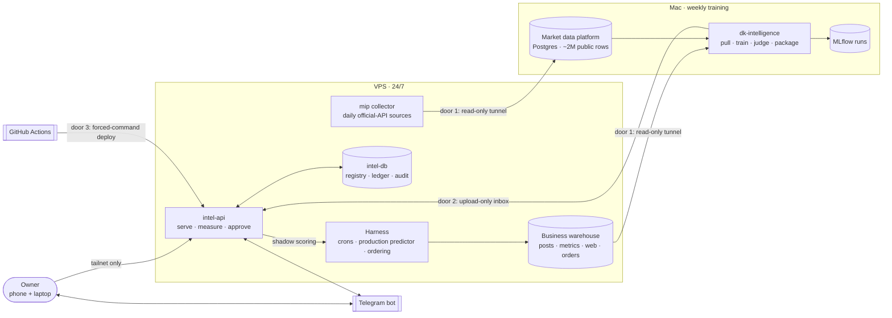
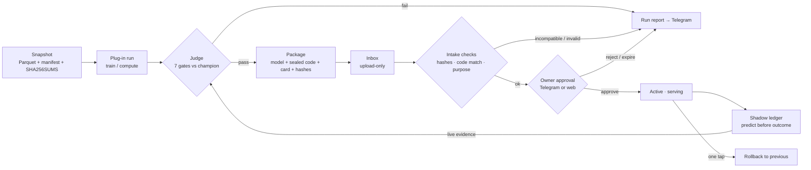
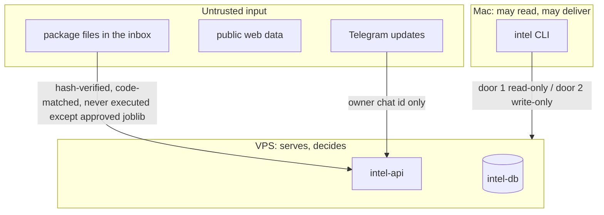

# dk-intelligence — architecture

The models and MLOps of Dhaka Kacchi Berlin (a homemade kacchi biryani kitchen). This page explains the system from
the outside in: context, containers, the life of a model, and where the trust boundaries are. The reasons behind each
choice are in the [decision records](adr/README.md).

## 1. Context: what talks to what



## 2. Containers and responsibilities

| Container | Where | Responsibility | Limits |
|---|---|---|---|
| `intel` CLI (`intel weekly`) | Mac, launchd Sun 12:00 + hourly catch-up | pull snapshots, run model plug-ins, judge, package, upload, report | runs only while training |
| Control Room (`intel control`) | Mac, 127.0.0.1 | live pipeline diagram, Run button, review-check page | loopback + token |
| `intel-api` | VPS, Docker | load approved packages, `/v1/predict`, `/v1/score`, ledger, web pages, Telegram | 512 MB |
| `intel-db` | VPS, Docker (pgvector pg16) | registry, approvals, activations, ledger, event log | 384 MB, no published port |
| Market data platform | Mac (+ VPS collector) | public market data → versioned marts | separate repo (`mip`) |
| Monitoring (`dk-monitoring`) | VPS, Docker | Prometheus, Alertmanager → Telegram, Grafana (tailnet :8443), node-exporter, blackbox probe of `/health/deep` (ADR 0016) | ~800 MB limits total |

## 3. The life of a model



1. **Snapshot** (ADR 0004): every input is an immutable, checksummed folder; ids travel with the model. Then the
   **data contracts** (ADR 0017): a warehouse pull that breaks one stops the run; a bad market snapshot falls back.
2. **Plug-in run** (ADR 0009): each model is a `ModelPlugin`; the Sunday run executes them in `order`.
3. **Judge** (ADR 0005): same newest-posts test set for challenger and champion; all gates must pass.
4. **Package** (ADR 0007): sealed feature code + hashes + model card + judge report + SHA256SUMS.
5. **Intake**: the VPS re-verifies every hash and compares the sealed code with its own (ADR 0011 keeps them in step).
6. **Approval**: a human decision for every scorer; insights auto-refresh after their first approval (ADR 0008).
7. **Serve + measure** (ADR 0006): predictions are registered before outcomes exist; they feed the next judge.

## 4. Code map

```
src/intel/
  plugins.py          ModelPlugin contract, discovery, validation             (ADR 0009)
  pipeline.py         core steps + plug-in steps -> the diagram and the run order
  weekly.py           the Sunday run: wait → pull → market → ledger → plug-ins → judge → package → upload → report
  pull.py, market.py  immutable snapshots (warehouse, market platform)       (ADR 0004)
  judge.py            gates, paired bootstrap CI, live gate                   (ADR 0005)
  package.py          seal / verify / upload packages                          (ADR 0007)
  sealed.py           sealed-code lock                                         (ADR 0011)
  quality/            data contracts, validator, data cards                     (ADR 0017)
  models/<name>/      plugin.py + spec.yaml + the model's code (one folder per model)
  serve/              intel-api: app, registry, measure (ledger), runs, telegram, views
  control.py          the Mac Control Room
```

## 5. Trust boundaries



- The Mac cannot read or delete anything on the VPS except through the read-only warehouse role (ADR 0003).
- Web decisions need the Tailscale identity header **and** a CSRF token; pages are reachable only on the tailnet.
- Telegram accepts commands only from the owner's chat id; only the VPS polls Telegram.
- Secrets live in `.env` files on each machine, never in git (pre-commit + CI scan the full history).

## 6. Quality gates (every commit)

| Check | Where | Rule |
|---|---|---|
| ruff lint + format | pre-commit, CI | no warnings |
| mypy | pre-commit, CI | whole package clean; 14 core modules `--strict` (ADR 0010) |
| sealed-code lock | pre-commit, CI | sealed files match `sealed-code.lock.json` (ADR 0011) |
| secret scan | pre-commit (staged), CI (full history) | gitleaks: no findings |
| tests + branch coverage | CI | all pass; coverage ≥ floor in `pyproject.toml` |
| shellcheck + actionlint | pre-commit, CI | deploy/automation scripts and workflows lint-clean |
| dependency audit | CI | pip-audit over every locked package (with hashes): no known vulnerability |
| image scan | CI | trivy on the pushed digest: no fixable HIGH/CRITICAL; report + SBOM kept (ADR 0014) |
| migrations | CI | additive only, unless marked `-- contract:` (ADR 0015) |
| monitoring as code | CI | promtool config + **alert-rule unit tests**, amtool, compose, dashboard PromQL (ADR 0016) |
| deploy | CI → door 3 | that exact digest; smoke test in the container; automatic rollback on failure (ADR 0014) |
