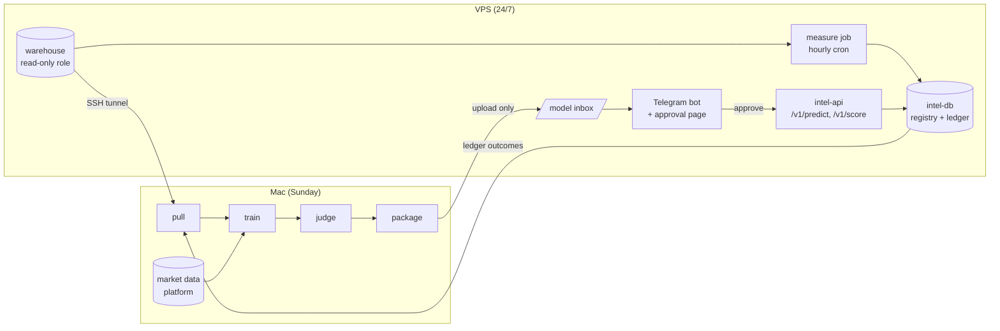

# dk-intelligence — Phase 1 plan: the walking skeleton

Status: DRAFT for owner approval · 2026-10-07

## 1. Goal

Build the smallest system that runs the whole loop **once, end to end, automatically**, with one real model:

> collect → train (Mac, Sunday) → judge → package → approve (Telegram / web) → serve (VPS) → measure real results → feed the next training

The first model is a **content scorer**: "Will this post do better than our usual post on this platform?" It
must beat the model already running on the VPS (the harness predictor) in a fair test before it replaces it.

Phase 1 is about the **pipes**, not about a clever model. Once the pipes work, every later model (community map,
creator matcher, timing planner, funnel) plugs into the same pipes (Phase 2). MCP comes in Phase 3, agents in Phase 4.

**Out of scope for Phase 1:** RAG, MCP, agents, content generation, sales models (only 9 orders so far), Dagster.

## 2. The picture



## 3. How each part works

### 3.1 Pull (Mac, Sunday)
- Opens the SSH tunnel (door 1) itself and closes it when finished.
- Copies the warehouse tables the model needs (`social_post`, `social_metrics_snapshot`, `campaign_variant`, the
  web tables), plus the prediction ledger, into **Parquet files**: `data/pulls/<date>/`.
- Writes a manifest with row counts and SHA-256 hashes. Every training run names the exact pull it used, so any
  result can be reproduced.
- Reads market knowledge from the data platform (`localhost:5434`, read-only `mip_reader`): peer lift by
  format, topic, language and occasion from 1.87M market posts.

### 3.2 Model package format (the "plug-in" rule)
Every model is one folder. Adding a model later means adding a folder, nothing else:

```
models/content_scorer/
  spec.yaml      # name, owner, label, metric, gates, schedule
  features.py    # ONE feature function, used by training AND serving (no skew)
  train.py       # train(data) -> fitted model
  predict.py     # predict(model, input) -> score + top reasons
```

The packaged output is `content_scorer-<version>.tar.gz`, containing:
- the model file;
- `features.py` and `predict.py`;
- `metadata.json` (pull id, git commit, metrics, threshold);
- `model_card.md`;
- `SHA256SUMS`.

### 3.3 The first model: content scorer v1
- **Same question as the current predictor, for a fair fight.**
  - Label: likes + comments + shares above this platform's *expanding* median up to that date.
  - Platforms: Facebook and Instagram.
  - Threads (almost all zeros) and YouTube (4 posts) stay out for now.
- **Only information known before posting:** platform, format, planned day and hour, and the caption text.
- **What it adds over the current model:**
  - **Caption features:** length band, language (German / English / Bengali), question, emoji count, hashtag
    count (1–3 rule), and hook type.
  - **Topic tags** from the data platform's dictionary (dish, halal, Eid, offer, sold out, behind the scenes…).
  - **Market priors:** how this format and topic perform for similar food accounts in the 1.87M market posts.
    This is our real advantage, because 461 own posts are too few to learn everything alone.
  - **Occasion closeness:** days to Eid, Ramadan, Christmas, Karneval der Kulturen, and so on.
- **Model types:** a calibrated logistic regression and a small gradient-boosted tree. The judge decides; we keep
  the simpler one if it's a tie.
- **Honest expectation:** with this little data, the gain may be small at first. The value of Phase 1 is that
  it gets better **every week by itself** as real results come in.

### 3.4 Judge (automatic gates, then you)
A challenger is offered to you only if it passes all of these:

| Gate | Rule |
|---|---|
| Data | The pull isn't smaller than last week's by more than 20%. No feature is dated after the post time (leakage check). |
| Fair test | Same time-ordered holdout for champion and challenger: the most recent ~20% of posts, never seen in training. |
| Better | Balanced accuracy at least **+0.02** over the champion, and AUC not worse. |
| No platform worse | Neither Facebook nor Instagram drops by more than 0.03. |
| Calibrated | Brier score not worse. A "70%" must mean about 70%. |
| Live evidence | Once the ledger has ≥ 30 measured posts, live accuracy must also not be worse. Until then the message says "not enough live evidence yet". |
| Works | The package loads, gives the expected answers on 10 fixed test posts, answers in < 200 ms, and is < 50 MB. |

Every run, pass or fail, writes a short **judge report**. Experiments are tracked in **MLflow** (local on the
Mac), so you can compare runs.

### 3.5 Approval: Telegram + small web page
- **Separate bot:**
  - It only talks to your chat id (allow-list) and ignores everyone else.
  - It uses polling, not a webhook, so **nothing new is exposed to the internet**.
- **Message when a challenger passes:**
  - what changed;
  - old vs new scores;
  - the biggest reasons;
  - buttons **Approve / Reject / Details**.
  - A rejection asks for a one-tap reason, which is saved for learning.
- **Web page:**
  - Served by `intel-api` **only on the VPS Tailscale address**, so only your own devices can open it.
  - Shows pending approvals, the model card, the judge report and the live ledger chart.
- **Undo:** after approval, the new model goes live and the old one is kept. `/rollback` in Telegram or one button
  switches back in seconds.
- **Expiry:** an unanswered approval expires after 7 days. The old model simply keeps serving.
- **Cockpit:**
  - Phase 1 keeps approvals in `intel-db`.
  - Mirroring them into the harness `agent_action` table, so they appear in the CEO cockpit, comes later: the
    cockpit doesn't read that table yet, and writing to the warehouse needs its own narrow role.

### 3.6 Serving (VPS, 24/7)
- **`intel-api`** (FastAPI, memory limit 384 MB):
  - `POST /v1/predict`: **the same contract as the current predictor** (platform, contentType, caption,
    plannedPostedAt → probability, threshold, model_version, top_reasons). The admin `/admin/post-predict` page
    can switch to it by changing one setting (`PREDICTOR_URL`), and switch back the same way.
  - `POST /v1/score`: a richer answer for later agents (all models, reasons, and which market examples support
    the score).
  - It is not published on a public port. It is reachable from the docker network and the Tailscale address only.
- **`intel-db`**: its own small Postgres with pgvector (memory limit 512 MB). It holds the model registry,
  approvals and the prediction ledger. The harness Postgres image and the ordering database are **not touched**.
- **Total extra memory on the VPS:** under 1 GB. It runs in the harness docker network, with the same compose and
  deploy style.

### 3.7 Prediction ledger and measurement (the feedback loop)
- **Shadow scoring of every real post:**
  - Every hour, a cron job finds new posts in the warehouse.
  - It scores each one with **the champion, the challenger, and the old harness predictor**, using only the
    pre-posting information.
  - It writes the result to the ledger.
  - **This needs no change in how you work.**
- **Outcomes:** at **24 h, 72 h and 7 days** after posting, the same job records the real numbers from
  `social_metrics_snapshot` (reach, likes, comments, shares, saves, clicks) and whether the label came true.
- **Next training:** the Sunday run pulls the ledger. Real outcomes become new training rows, and live accuracy
  becomes a judge gate (3.4).
- **Drift alert:** if the champion's live accuracy over the last 30 measured posts drops below the old
  predictor's, Telegram says so.
- **Link to the prediction id:** when the link builder is used, the prediction id can go in `utm_content`. That's
  ready for the attribution work in Phase 2.

### 3.8 Schedule
| When | Where | What |
|---|---|---|
| Every hour | VPS cron | measure: shadow-score new posts, record outcomes |
| Sunday after the data platform's weekly refresh (about 12:00) | Mac launchd | pull → train → judge → package → upload |
| Right after upload | VPS | validate package → Telegram approval message |
| Monday 09:00 | VPS | weekly Telegram report: live accuracy, posts measured, model in use |
| If no new candidate for 14 days | VPS | Telegram reminder ("Mac didn't train") |

If the Mac is off on Sunday, nothing breaks. The VPS keeps serving the current model, and the run happens next
time the Mac is awake.

## 4. Security (the three doors)
1. **Data tunnel (done):**
   - `intel` SSH user; it can only forward to the database port, only from the Mac's Tailscale address.
   - Database role `intelligence_reader`, read-only.
2. **Model inbox (M4):** an upload-only key into one folder (`rrsync -wo`), only from the Mac. It can't read,
   delete or run anything.
3. **Code deploy (M5):** GitHub Actions with a forced-command key that can only run `dk-intelligence`'s
   `deploy.sh`, like the harness.

Other rules:
- Claude never gets a shell on the VPS.
- Secrets live only in `.env` files, never in git or chat.
- No personal data leaves the warehouse: it is already minimised (no names, emails or phones).

## 5. Milestones (each one small, testable, and shown to you)

| # | Milestone | Done when |
|---|---|---|
| M0 | Repo scaffold: uv, tests, lint, `.env.example`, README, CLAUDE.md conventions | `pytest` green in CI |
| M1 | `intel pull`: tunnel + Parquet snapshot + manifest | Today's warehouse pulled; counts match the live tables |
| M2 | Reproduce the champion: score the current harness predictor on our holdout | We get its published numbers (≈ 0.60 balanced accuracy) or explain the difference |
| M3 | Content scorer v1: features, training, MLflow, judge report | Judge report for v1 vs champion, pass or fail, honest |
| M4 | Package + inbox upload (door 2) | A package lands on the VPS, checksums verified |
| M5 | VPS: `intel-db`, `intel-api`, Telegram bot, approval page, deploy (door 3) | You approve from Telegram and `/v1/predict` answers with the new version; rollback works |
| M6 | Ledger + hourly measurement | New real posts appear in the ledger with 24h/72h/7d outcomes |
| M7 | Sunday automation on the Mac + Monday report | One full unattended Sunday run, from pull to Telegram message |
| M8 | (Your decision) point `/admin/post-predict` to `intel-api` | The admin page shows the new model; one-line switch back |

Rough effort: M0–M3 about 2–3 working sessions; M4–M7 about 3–4 sessions. The first real automated Sunday comes
after M7.

## 6. What I need from you, and when

| When | What |
|---|---|
| Now | Approve this plan, or change it |
| Before M5 | Telegram: create the bot with @BotFather (token into `dk-intelligence/.env` as `TELEGRAM_BOT_TOKEN`); send it one message so we can read your chat id |
| M4 | Run 4 commands on the VPS for door 2 (the inbox user); I'll give them then |
| M5 | Add one deploy key and 2 GitHub secrets for door 3, and allow a `dk-intelligence` checkout under `/opt/dhaka-kacchi/`; I'll give exact steps |
| M8 | Decide whether the admin page switches to the new model |

## 7. Decisions taken in this plan (say if you disagree)
1. **No Dagster in Phase 1.** One plain Python command (`intel weekly`) runs the steps in order and stops at the
   first failure. Dagster comes in Phase 2, when several models need scheduling.
2. **Same label as the current predictor** for the first fight. A reach-based label, better for "who sees it",
   is a Phase 2 challenger.
3. **Approvals live in `intel-db` first.** Mirroring to the cockpit's `agent_action` comes later.
4. **Telegram polling, approval page on Tailscale only:** zero new public endpoints.
5. **Facebook + Instagram only** in v1. Threads and YouTube get their own models when they have enough data.
